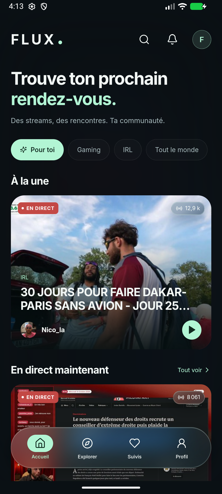

# FLUX

Un client Twitch indépendant en **Rust / Tauri 2**, avec une interface française pensée pour le mobile : verre dépoli, accent menthe et navigation flottante. Android et Windows.

Inspiré de [Xtra](https://github.com/crackededed/Xtra), sous **AGPL-3.0**. Le design original éditable est livré dans [Flux-Mobile.pen](Flux-Mobile.pen), avec ses règles dans [DESIGN.md](DESIGN.md).

[Télécharger la préversion Android / Windows](https://github.com/azksama/flux/releases/tag/v0.1.0-alpha.1) · [Résultats CI](https://github.com/azksama/flux/actions)



Capture de l’application native dans Android Emulator, le 14 octobre 2026. Les contenus Twitch varient. [Voir la version Windows](docs/images/windows-home.png).

## Fonctionnalités

- Directs, catégories, recherche, chaînes, biographies, replays et clips sur les services réels Twitch.
- Lecteur HLS persistant : qualité, faible latence, audio seul, plein écran, mini-lecteur, reprise des replays.
- Chat en direct, événements de modération, emotes Twitch, BTTV et 7TV ; envoi authentifié via Helix.
- Favoris locaux, import des suivis Twitch, historique, marque-pages et notifications dans l’application.
- Téléchargement de clips et replays terminés, lecture hors connexion, annulation et suppression.
- Connexion officielle par code Twitch. Coffre local facultatif protégé par mot de passe, Argon2id et AES-256-GCM.
- Paramètres persistants, contraste renforcé, réduction des mouvements, taille du chat et récupération des erreurs.
- Studio : informations de chaîne et modération via Helix ; accès aux outils officiels Twitch.

**Cette première version n’est pas une parité complète de Xtra.** La diffusion caméra/RTMP, le service audio Android en arrière-plan, Cast, les notifications push, le chat replay et la traduction ne sont pas implémentés. Les achats, l’identité du compte, les conversations privées complètes, les revenus et les statistiques avancées s’ouvrent sur Twitch. Consulte la [couverture des 76 maquettes](docs/SCREENS.md) et les [limites techniques](docs/ARCHITECTURE.md).

## Démarrer

Prérequis : Node.js 24, Rust stable et les [prérequis Tauri](https://v2.tauri.app/start/prerequisites/). Sous Windows : outils C++ MSVC et WebView2. Android : SDK, NDK et JDK 21+.

```sh
npm ci
npm run tauri dev
```

`npm run dev` seul est un **aperçu navigateur de la présentation**. Les services Twitch natifs nécessitent Tauri.

### Connecter Twitch

Le catalogue public, les vidéos accessibles et les favoris locaux fonctionnent sans compte. Pour envoyer des messages, importer tes suivis ou gérer ta chaîne :

1. Enregistre une application de type **Public** dans la [console développeur Twitch](https://dev.twitch.tv/console/apps).
2. Colle son **Client ID**, jamais un secret, dans FLUX → Connexion Twitch.
3. Ouvre l’autorisation Twitch, entre le code affiché et reviens dans FLUX.
4. Facultatif : crée ton coffre depuis Mon compte pour conserver la session entre les lancements.

Les opérations personnelles nécessitent les autorisations et rôles Twitch correspondants. Aucun compte, jeton, secret ou mot de passe n’est embarqué.

### Android

```sh
npm run tauri android init --ci
npm run tauri android build --debug --target aarch64 --apk
```

Sous Windows, si les liens symboliques ne sont pas autorisés, utilise le script qui compile Rust puis copie la bibliothèque avant l’assemblage Gradle :

```powershell
./scripts/build-android.ps1 -Target aarch64 -OptimizedDebug
# Émulateur Android Studio :
./scripts/build-android.ps1 -Target x86_64 -OptimizedDebug
```

Le script prend `JAVA_HOME`, `ANDROID_HOME` et `NDK_HOME` dans l’environnement, ou les emplacements Android Studio habituels. L’initialisation Tauri reste nécessaire après un clone neuf pour générer les chemins Gradle locaux. `-OptimizedDebug` compile Rust en mode release et conserve un APK de test signé avec la clé debug locale. Sans cette option, Rust conserve ses symboles de débogage. Une distribution de production exige ta propre clé de signature.

### Windows

```sh
npm run tauri build -- --bundles nsis
```

## Vérifier

```sh
npm run build
npm test
npx playwright install chromium
npm run test:e2e
cargo test --manifest-path src-tauri/Cargo.toml --lib
cargo clippy --manifest-path src-tauri/Cargo.toml --all-targets -- -D warnings
# Contrôle réseau réel, lecture seule, facultatif :
cargo test --manifest-path src-tauri/Cargo.toml --lib public_twitch_catalog_and_media -- --ignored --nocapture
```

Le test Android instrumenté `FluxSmokeTest` lance le vrai WebView et vérifie catalogue, lecture vidéo, chat, mini-lecteur et contraste. Il utilise uniquement Android Emulator / ADB / AndroidX Test. Les preuves et limites constatées sont consignées dans [VALIDATION.md](VALIDATION.md).

## Sources et conception

- [Architecture et sécurité](docs/ARCHITECTURE.md)
- [Transposition du design et relecture](docs/IMPLEMENTATION_DESIGN.md)
- [Couverture des maquettes](docs/SCREENS.md)
- [Crédits et licences](THIRD_PARTY_NOTICES.md)
- [Documents de la phase design](docs/design/README.md)

Les interfaces publiques non documentées de Twitch peuvent évoluer. FLUX respecte les refus d’accès et propose d’ouvrir Twitch lorsque la lecture n’est pas disponible. FLUX n’est affilié ni à Twitch ni aux mainteneurs de Xtra.
